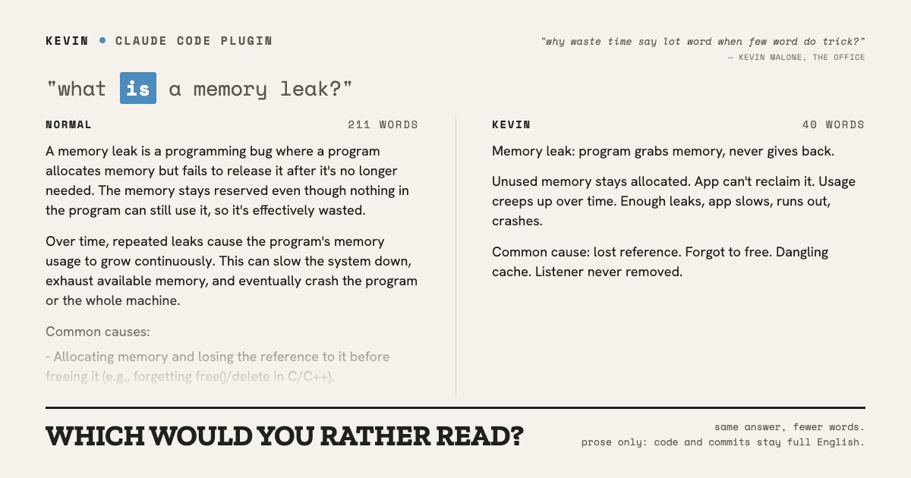
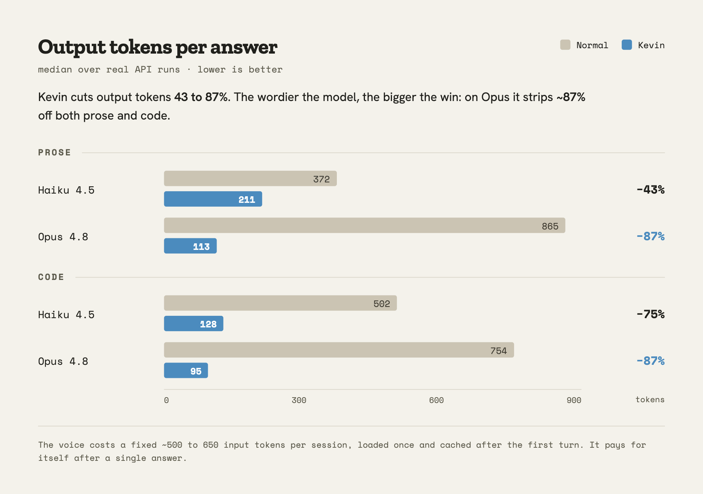
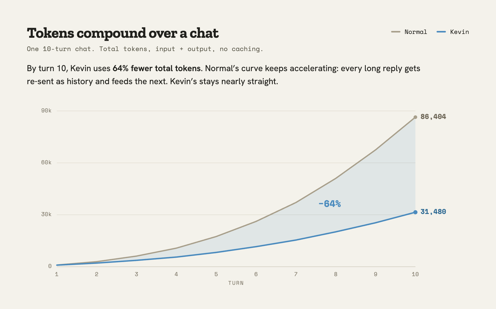

# kevin

Talk like Kevin from The Office. Fewest words that still carry the meaning.

> "Why waste time say lot word when few word do trick?"

Kevin Malone said that to defend the way he talks, and he had a point. Most of what an AI assistant types back at you is padding: throat-clearing, hedges, restating your own question, three sentences where one would do. Kevin is a portable [Agent Skill](https://agentskills.io) that strips it out. You get the answer, not the essay.

It governs prose only. Chat replies, summaries, explanations. It leaves code, commit messages, and anything that ships under a real name completely alone.

## Before / after

<a href="examples.md">
  <picture>
    <source media="(prefers-color-scheme: dark)" srcset="docs/before-after-dark.png">
    
  </picture>
</a>

Real captures, same prompt with and without Kevin. [See 30 more.](examples.md)

What Kevin won't touch: code, commit messages, PR descriptions, and security or destructive-action warnings stay in full, plain English. Compression is for the chat, not for the things you read back later under your name.

## Why this exists, and why it isn't really about tokens

Every compression tool in this space sells token savings. Kevin saves tokens too (numbers below), but that's not the reason to run it.

Tokens are cheap. A long-winded Opus answer costs a fraction of a cent. The resource you're actually spending is your own attention, reading the same preamble for the hundredth time today. That cost never shows up on an invoice, which is exactly why it's the one worth cutting. Kevin optimizes for your reading time. The API bill is an afterthought.

"Me fix." is clear and funny. Kevin bends grammar whenever the result stays obvious, but never crushes words together. Every requested option, constraint, and decision-relevant caveat stays. It doesn't add unasked coverage, repeat the verdict, or tack on a punchline. Replies come out concise on the first pass.

The token savings are a side effect. A good one.

## The savings

<picture>
  <source media="(prefers-color-scheme: dark)" srcset="docs/savings-dark.png">
  
</picture>

## It compounds over a chat

<picture>
  <source media="(prefers-color-scheme: dark)" srcset="docs/compounding-dark.png">
  
</picture>

A single answer understates it. The API is stateless, so the whole transcript rides along on every turn. Kevin's shorter replies keep that history lean, and the gap widens turn over turn. These are raw token counts; with caching the cost gap holds up, just driven by Kevin's shorter output rather than the smaller history.

## One skill, any compatible agent

[`skills/kevin/SKILL.md`](skills/kevin/SKILL.md) is the single source of truth. It follows the open Agent Skills format: standard YAML metadata plus Markdown instructions, with no scripts, network calls, or dependencies.

Install that folder using any agent's normal skill workflow. Invoke `kevin` explicitly when you want the most predictable activation. The exact syntax and install location belong to the host; common examples are below.

Turn it off by saying "stop kevin" or "normal mode." Turn it back on with "start kevin" or "kevin mode." The latest explicit choice wins while those instructions remain in context.

Agent Skills standardizes the package, not every host's lifecycle. A standard skill may load only when selected and may need to be invoked again after a new session, compaction, or subagent handoff. Kevin's optional plugin hooks preserve the old always-on behavior in hosts that support those hooks.

## Install

### Portable skill

Install [`skills/kevin/`](skills/kevin/) with your agent's documented Agent Skills flow. The folder can be copied, symlinked, or packaged without rewriting it.

The cross-harness [`skills` CLI](https://www.skills.sh/docs/cli) can discover the standard repository layout and install Kevin for the agents you select:

```sh
npx skills add grepsedawk/kevin --skill kevin
```

The CLI is optional; review it and the skill before running third-party installers.

- [Codex](https://developers.openai.com/codex/build-skills) discovers repository skills under `.agents/skills/` and user skills under `~/.agents/skills/`. Invoke with `$kevin`.
- [Claude Code](https://code.claude.com/docs/en/skills) discovers project skills under `.claude/skills/` and user skills under `~/.claude/skills/`. Invoke with `/kevin`.
- Other Agent Skills-compatible hosts use the same `SKILL.md`; follow that host's discovery or upload instructions.

Review third-party skills before installing them. This one contains instructions only.

### Plugin compatibility

The existing marketplace install remains available for Claude Code and Codex. It bundles the same portable skill plus two `SessionStart` hooks for startup/resume/clear and post-compaction reload.

Add the marketplace:

```
/plugin marketplace add grepsedawk/kevin
```

Then install the plugin:

```
/plugin install kevin@kevin
```

For Codex:

Add the marketplace and install the plugin:

```sh
codex plugin marketplace add grepsedawk/kevin
codex plugin add kevin@kevin
```

In Codex, open `/hooks`, review and trust both Kevin `SessionStart` hooks, then start a new thread. Enabling the plugin does not trust its hooks. Claude Code applies its own plugin and hook permission flow.

After an update, check `/hooks` again. Codex tracks trust for both hook definitions and plugin contents, so a voice-prompt change can require fresh approval even when the hook command is unchanged. Hooks marked for review are skipped.

## Benchmarks

Reproduce the charts:

```
python3 -m pip install anthropic
ANTHROPIC_API_KEY=... python3 benchmarks/run.py       # per-answer savings
ANTHROPIC_API_KEY=... python3 benchmarks/session.py   # 10-turn compounding
```

`run.py` reports the output-token delta split into prose and code buckets. `session.py` runs one scripted conversation through both arms and records per-turn and cumulative tokens. Set `KEVIN_BENCH_MODEL` to test another model; `run.py` also takes `KEVIN_BENCH_TRIALS` (default 5).

Test prompt quality with Codex while editing. Choose the model you actually use:

```sh
python3 benchmarks/codex_eval.py --model gpt-6-astra
```

The model is required, either through `--model` or `KEVIN_CODEX_MODEL`. The judge uses the same model unless you pass `--judge-model`.

The evaluator compares the working skill with `HEAD` (and understands the pre-0.3 `kevin-voice.md` path). Identical prompts fail before any model calls. After committing, choose an older baseline:

```sh
python3 benchmarks/codex_eval.py --model gpt-6-astra --baseline-ref HEAD^
```

Three batched calls generate both sets of answers and a blinded comparison. Cases cover concise updates, recommendations, requested scope, mixed validation results, professional artifacts, and safety. The judge checks meaning separately from style. Clear broken grammar is allowed; polish and unasked detail earn no extra credit.

A run passes only when the candidate preserves the required meaning and wins more comparisons than it loses. Ties alone don't establish an improvement. Each run saves the prompts, hashes, models, answers, checks, and verdicts in an ignored JSON report under `benchmarks/results/`, including failed comparisons. Use `--output` to choose another path. Inspect the saved answers; one judge run is a screening result, not proof of consistent improvement.

Run the local checks without model calls:

```sh
bash tests/activate.test.sh
python3 -m unittest discover -s tests -p 'test_*.py'
```

## License

MIT. See [LICENSE](LICENSE).
